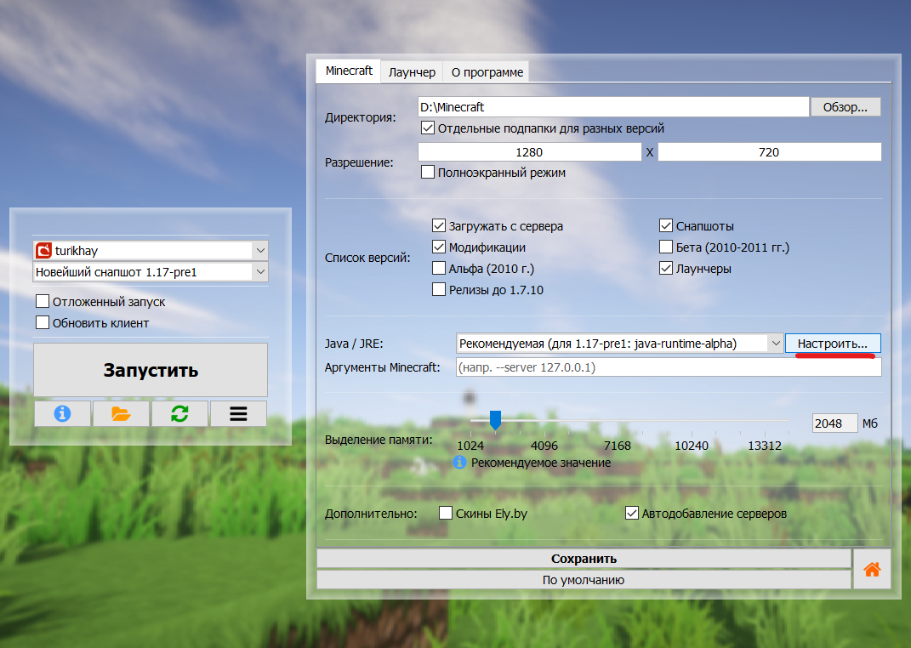
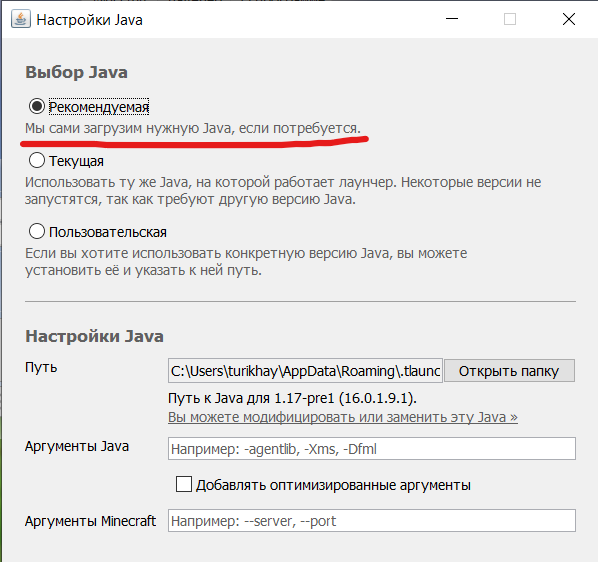
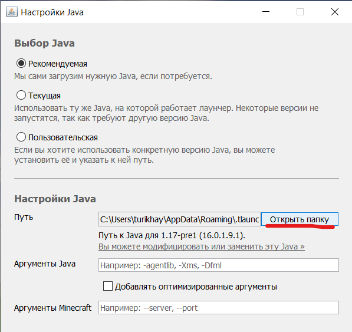

# Using custom Java versions
Legacy Launcher uses Mojang's recommended Java builds by Microsoft. This guide will help you to replace these Java versions with the ones of your choice.
:::info
This page requires localization of screenshots. Feel free to [open a PR](https://github.com/LegacyLauncher/docs) if you want to help
:::

## How to? {#how-to}
1. Install required Minecraft version
2. Open launcher settings, select "Minecraft" tab and open Java settings
    
3. Select "Recommended" option
    
4. Click "open folder"
    
5. In the folder, create a file named `override`, e.g. `override.txt`
    
6. Done! Now the Java files in this folder can be freely modified or replaced, and the launcher will not try to re-download them
:::tip[Where can I get alternative Java distributions?]
You can download alternate Java distributions from their developers' websites, such as [Temurin](https://adoptium.net/temurin/releases/?package=jre) and [Azul](https://www.azul.com/downloads/#downloads-table-zulu). *You should download the **archive**, not the installer*.
:::

## Simplified method {#how-to-simplified}
Due to complaints about the stability of Mojang recommended Java builds we have prepared a ready-to-use package to replace Java with more stable ones.
1. Download the archive:
    * [For 32-bit Windows](https://disk.yandex.ru/d/xcXWahjDYbKqKg)
    * [For 64-bit Windows](https://disk.yandex.ru/d/6sEKgkJNeT90fA)
    :::note[Sources]
    Java versions for these archives are taken from open sources: [Adoptium Temurin](https://adoptium.net/temurin/releases/?package=jre) (Java 8, Java 17) and [AdoptOpenJDK](https://github.com/AdoptOpenJDK/openjdk16-binaries/) (Java 16)
    :::
2. Open the launcher settings, select "Minecraft" tab and go to Java settings
    .
3. In the window that opens, select the "Recommended" option
    
4. Click "Open Folder"
    
5. In the opened folder, **go up two levels**.
    :::tip
    If you see folders named `java-runtime-alpha`, `java-runtime-beta`, `java-runtime-gamma`, `jre-legacy` then you have done everything correctly
    :::
    :::warning
    If you see the `.version` file next to a folder and/or don't see any other Java folders, or see `lib` and `bin` folders - you're probably in the wrong folder
    :::
6. Replace the folder contents with the contents of the downloaded archive.
7. Run the launcher and the game

## Setting custom JRE using the launcher settings {#settings-custom-jre}
:::danger[This method is not recommended]
This method will override Java for **all Minecraft versions**. Make sure you switched Java back to "Recommended" when changing Minecraft version or modpack!
:::

1. [Download and install required Java version](./java.mdx)
2. Open the launcher settings, select "Minecraft" tab and go to Java settings
    .
3. In the window that opens, select the "Custom" option
4. Click "Browse" button near the Path field and select `bin/java.exe` (for Windows) or `bin/java` (for Linux/macOS) executable for installed Java version
    :::note[Default Java install locations]
    **Windows**: Check Java installer settings. In most cases it will install Java to `C:\Program Files`  
    **Linux**: Most package managers will install Java under `/usr/lib/jvm` path  
    **macOS**: In most cases you'll find installed Java under `/Library/Java/JavaVirtualMachines` and `~/Library/Java/JavaVirtualMachines` paths  
    :::
    :::warning
    When pasting Java path manually make sure there are no quotes surrounding the path
    :::
5. Click "Done" button

## The Hard Way {#edit-version}
:::warning
This method is recommended for experienced users only
:::
:::tip
This method is recommended for modpacks and custom versions
:::

1. Start Legacy Launcher
2. Click "Open game folder" (the one with folder icon) button to open game folder
    
    * Launcher may ask you to select a folder. You should select "root folder"
        
3. Open `versions` folder
    
4. Find the version you want to use a specific JVM with
    :::tip
    You may want to [clone](./custom-versions.md) this version
    :::
5. Open the version json file with any text editor (e.g. [Notepad++](https://notepad-plus-plus.org/downloads/))
    :::note
    You **should not** use any office suite!
    :::
6. Find `javaVersion` block
7. Change the `component` field value to one of the following:
    :::note
    This list may be incomplete. You can view all available JVM versions [here](https://launchermeta.mojang.com/v1/products/java-runtime/2ec0cc96c44e5a76b9c8b7c39df7210883d12871/all.json).
    :::
    * `jre-legacy` for Java 8
    * `java-runtime-alpha` for Java 16
    * `java-runtime-beta` and `java-runtime-gamma` for Java 17
    * `java-runtime-delta` for Java 21
    * `java-runtime-epsilon` for Java 25
8. Save json file and restart the launcher. The version should now use selected Java version.
    :::note
    "Force update" checkbox will revert this change back to normal.
    :::
