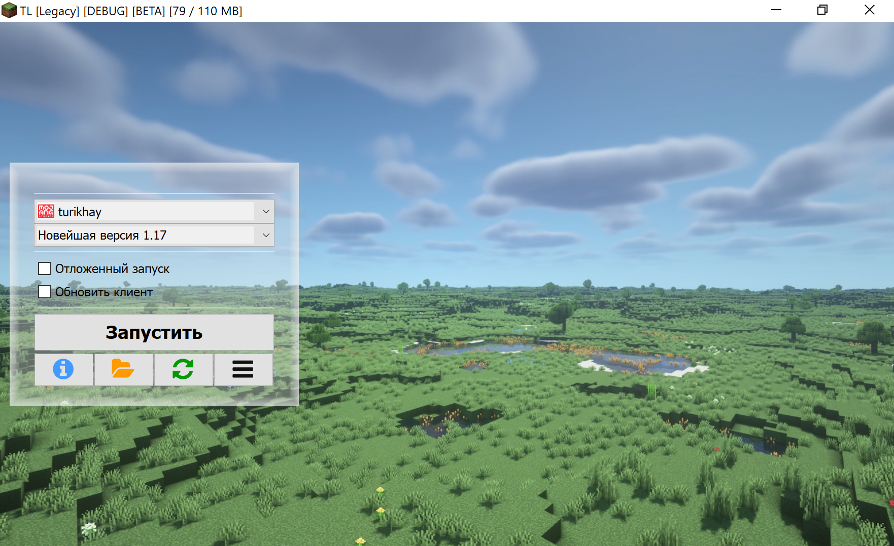
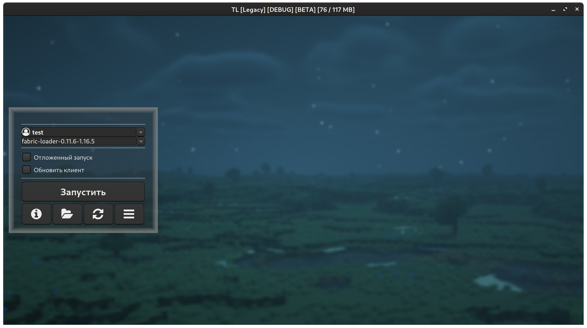

# HiDPI
:::info
Legacy Launcher supports HiDPI since 1.123.0
:::
:::info
This page requires localization of screenshots. Feel free to [open a PR](https://github.com/LegacyLauncher/docs) if you want to help!
:::

## Windows and macOS {#windows-macos}
:::note
HiDPI support requires Java 11 or newer
:::

The interface scale is respected automatically starting with Java 11.

## Linux {#linux}
:::note
Linux HiDPI support requires Java 11.0.12 and later, or Java 17 and later
:::

The launcher was tested in GNOME 40 environment with GTKLookAndFeel on AdoptOpenJDK 11.0.12.

If the launcher is running with a regular L&F and/or no scaling, it can be started like this:
1. Set [the arguments file](./portable) (set the `TL_UI_SCALE` variable as a number, e.g. `1.25` or `2`)
    ```bash
    TL_UI_SCALE=
    [ -z "$TL_UI_SCALE" ] && echo "Don't just copy-paste. Please actually set TL_UI_SCALE" >&2 || cat <<EOF > tl.bootargs
    -Dsun.java2d.uiScale=$TL_UI_SCALE
    -Dswing.defaultlaf=com.sun.java.swing.plaf.gtk.GTKLookAndFeel
    -Dswing.crossplatformlaf=com.sun.java.swing.plaf.gtk.GTKLookAndFeel
    EOF
    ```
2. Start the launcher
    ```bash
    java -jar LegacyLauncher.jar
    ```
